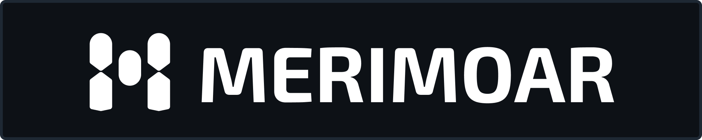
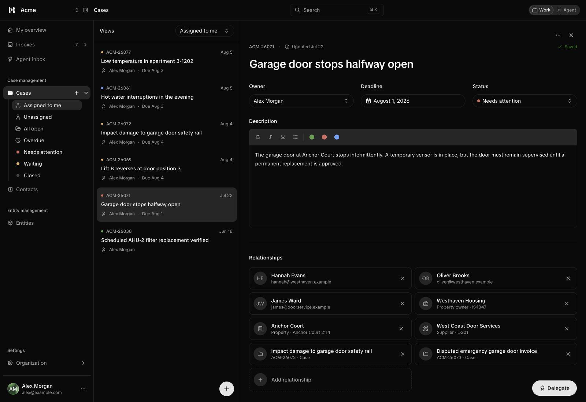
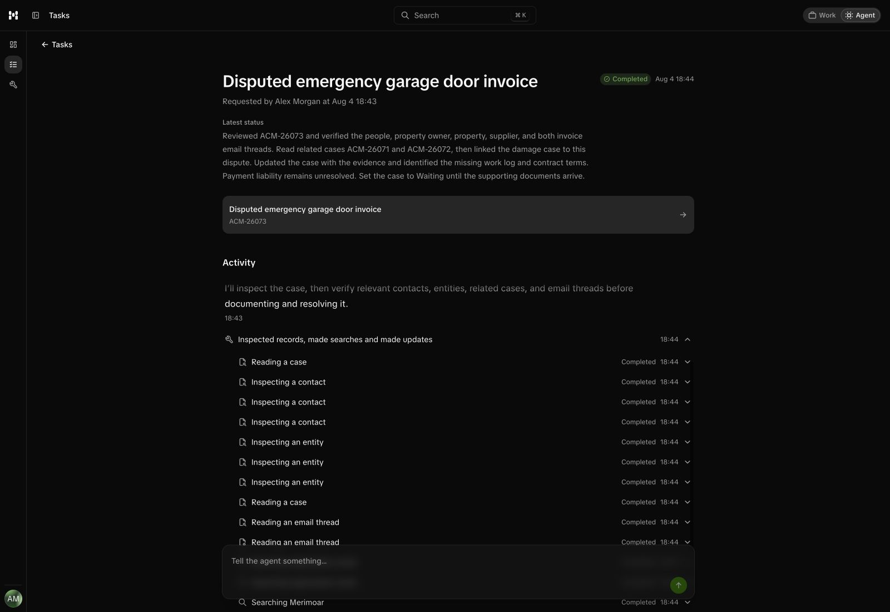
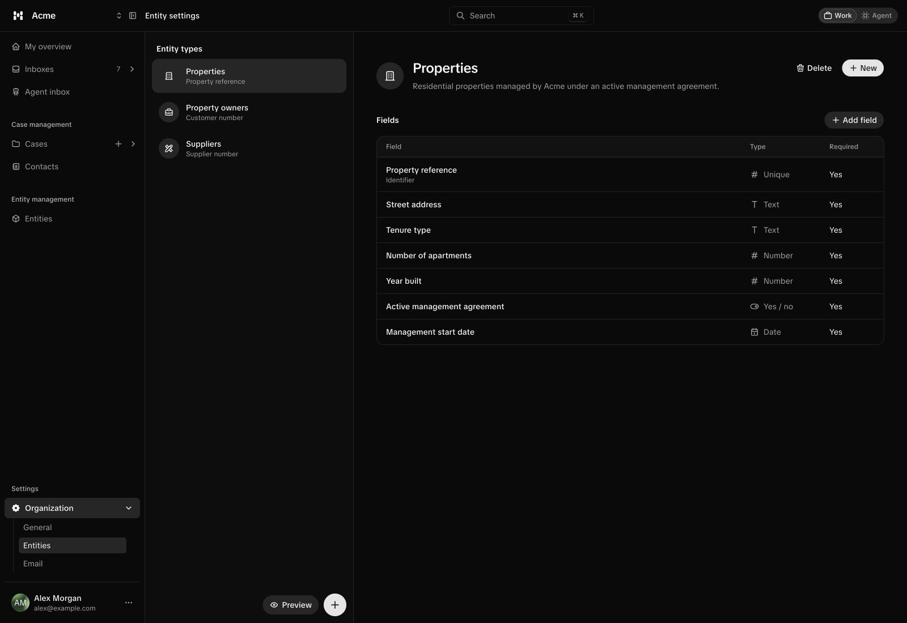

Agentic case management, built around your business model.

Merimoar is an agentic case management system. Agents handle cases from
investigation to resolution, using email, contacts, and a business model you
define.

Create your own entity types with typed fields and connect reusable
records to cases, so agents work with your organization's actual structure.
Follow their activity, steer their work, review approvals, or take over at any
point.

## Cases and agents

Keep email, contacts, and business records together in a case. Follow an agent's
investigation, inspect its tool activity, and steer its work as it happens.

Connect your own tools through HTTPS APIs or webhooks that accept JSON POST
requests and return JSON responses.

<p>
  
  
</p>

## Your business model

Your domain model evolves as you work. As you connect cases, contacts, and
business records, each new relationship adds context for you and your agents
to draw on in future work.

Define entity types such as properties, contracts, or invoices with typed fields
and required values. Reuse the same records across cases.



## The broad idea

Agents need context about a business's processes, practices, and recurring
problems to do useful work. The idea behind Merimoar is to build that context
as a business ontology: a shared model of the business's concepts and how they
relate, informed by two kinds of knowledge.

- Top-down knowledge comes from experts who describe how the business works,
  for example through agent skills, procedures, and policies.
- Bottom-up knowledge comes from daily operations: emails, cases, customers,
  business records, and the relationships built between them as work happens.

Merimoar collects the bottom-up knowledge. Combined with expert knowledge, it
builds a business ontology grounded in both intended processes and actual work.
The goal is to make this context available through a semantic layer, so other
agents can understand the business and automate more of its operations.

## Run locally

| Requirement | Version or purpose |
| --- | --- |
| Bun | 1.3.14 |
| Node.js | 22.11 or newer |
| Convex | Development deployment for the database and backend |
| WorkOS | Development account for authentication and organizations |
| OpenAI | API access for agent execution |
| Gemini | API access for semantic email suggestions |
| Resend | Email integration through WorkOS Pipes |

```sh
bun install
cp .env.example .env.local
```

1. Run `bun run dev:convex` to select a development deployment. Set
   `VITE_CONVEX_URL` in `.env.local` to its `.convex.cloud` URL. Configure the
   deployment's server environment variables listed in
   [convex.config.ts](packages/convex/convex.config.ts) through the Convex
   dashboard or `bunx convex env set`.
2. Configure WorkOS AuthKit with
   `http://localhost:3000/api/auth/callback` as the redirect URI. Fill in the
   WorkOS values in `.env.local`, including a random cookie password of at least
   32 characters. Set the same WorkOS client ID and API key in Convex.
3. Point a WorkOS webhook at
   `https://<your-deployment>.convex.site/workos/webhook` and set its signing
   secret in Convex. Subscribe to user, organization, and organization membership
   created, updated, and deleted events. Create a development organization and
   add your user as a member after configuring the webhook.
4. Keep `bun run dev:convex` running and start `bun run dev` in another terminal.
   Open [localhost:3000](http://localhost:3000).

To run agents, follow the [worker setup](docs/agent-runtime.md#local-setup) and
start `bun run dev:agent`. Convex Cloud needs a public HTTPS URL for the worker,
so local development requires a tunnel to port 3001.

See [email integration](docs/resend-pipes.md) and
[semantic case suggestions](docs/semantic-case-suggestions.md) for the remaining
integrations.

## Under the hood

- TypeScript and Bun for the workspace and tooling.
- TanStack Start and React for the application.
- Convex for the database and backend functions.
- WorkOS for authentication and organizations.
- Tailwind CSS and shadcn/ui for styling and UI components.

### Packages

- `packages/web`: the application.
- `packages/convex`: database, functions, and generated client API.
- `packages/agent` and `packages/agent-worker`: portable agent runtime and Node host.

[Agent runtime](docs/agent-runtime.md)

## License

Copyright 2026 Adam Gustafsson. Licensed under [AGPL-3.0-only](LICENSE).
Third-party materials retain their own licenses; see
[third-party notices](THIRD_PARTY_NOTICES.md).
